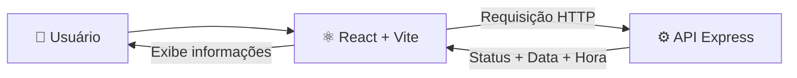
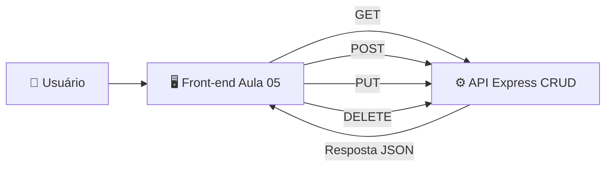
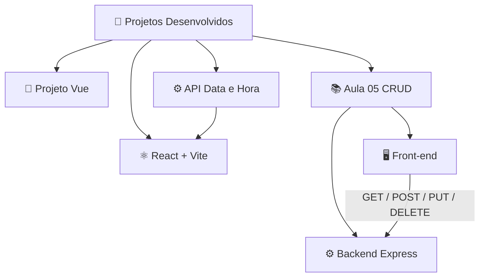

# 🚀 Projetos Desenvolvidos

  Projetos desenvolvidos durante os estudos de <strong>Front-end, Back-end e APIs REST</strong>.

---

# 📘 01 — Projeto Vue.js

Aplicação desenvolvida utilizando **Vue.js** e publicada na **Vercel**.

### 🔗 Links

| Repositório                                        | Projeto Online                                           |
| -------------------------------------------------- | -------------------------------------------------------- |
| 💻 [GitHub](https://github.com/jwlioo/projeto_vue) | 🌐 [Acessar Projeto](https://projetovue-rho.vercel.app/) |

### 🛠️ Tecnologias

`Vue.js` • `JavaScript` • `HTML` • `CSS` • `Vercel`

---

# ⚙️ 02 — API Express: Status, Data e Hora

Projeto **Back-end independente**, desenvolvido utilizando **Node.js + Express**.

Esta API possui uma funcionalidade simples para retornar informações como:

* ✅ Status de funcionamento da API
* 📅 Data atual
* 🕒 Hora atual

### 🔗 Links

| Repositório                                            | API Online                                                   |
| ------------------------------------------------------ | ------------------------------------------------------------ |
| 💻 [GitHub](https://github.com/jwlioo/express-backend) | 🌐 [Acessar API](https://express-backend-lueb.onrender.com/) |

### 🛠️ Tecnologias

`Node.js` • `Express.js` • `JavaScript` • `Render`

---

# ⚛️ 03 — Front-end React + Vite

Projeto **Front-end desenvolvido com React + Vite**.

Este projeto foi criado especificamente para **consumir a API Express de Status, Data e Hora apresentada no projeto anterior**.

### 🔗 Repositório

| GitHub                                                               |
| -------------------------------------------------------------------- |
| 💻 [Acessar Repositório](https://github.com/jwlioo/Frontend-Express) |

### 🔄 Comunicação com a API

### 🛠️ Tecnologias

`React` • `Vite` • `JavaScript` • `Fetch API`

---

# 📚 04 — Aula 05: CRUD com Express

> ⚠️ **Este é um projeto diferente da API de Data e Hora.**

Projeto desenvolvido durante a **Aula 05**, praticando operações de uma **API REST**.

O projeto possui um **Front-end separado** e um **Back-end separado**.

### ⚙️ Operações praticadas

| Método      | Função          |
| ----------- | --------------- |
| 🟢 `GET`    | Buscar dados    |
| 🔵 `POST`   | Criar dados     |
| 🟠 `PUT`    | Atualizar dados |
| 🔴 `DELETE` | Remover dados   |

---

## 🖥️ Front-end — Aula 05

Interface responsável por realizar as requisições para a API.

| Repositório                                                    | Projeto Online                                                     |
| -------------------------------------------------------------- | ------------------------------------------------------------------ |
| 💻 [GitHub](https://github.com/jwlioo/Express-frontend-aula05) | 🌐 [Acessar Front-end](https://express-aula05-backend.vercel.app/) |

---

## ⚙️ Back-end — Aula 05

API desenvolvida utilizando **Node.js + Express**, responsável pelas operações CRUD.

| Repositório                                                   | API Online                                                     |
| ------------------------------------------------------------- | -------------------------------------------------------------- |
| 💻 [GitHub](https://github.com/jwlioo/Express-backend-aula05) | 🌐 [Acessar API](https://express-backend-aula05.onrender.com/) |

---

## 🔄 Arquitetura da Aula 05

---

# 🗂️ Visão Geral

---

## 🛠️ Tecnologias Praticadas

---

  👨‍💻 <strong>Projetos desenvolvidos para prática e evolução em Desenvolvimento Web.</strong>

